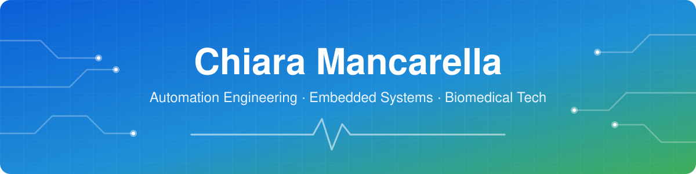

  

  

  

---

## 👩‍💻 About me

<table>
<tr>
<td width="60%" valign="top">

I'm an **Automation Engineering student at the University of Padova** who loves building things that sense, decide and act: embedded systems, control logic and the software that ties them together.

I mix technology and creativity, from **3D printing** and **IoT** to **AI** experiments, and I love teaching what I learn.

🎯 **Goal:** bring all this into **biomedical research and industry**, and one day found my own company in the field.

</td>
<td width="40%" valign="top">

- 🔭 Working on **ESP32 / IoT** projects
- 🎓 Halfway through my **bachelor's degree**
- 🧑‍🏫 **Tutor** and **course designer**
- 🤖 **AI workshop** facilitator
- 👩‍💻 **Community Lead** @ RestartHer Academia
- 💜 Member of **Women Techmakers**

</td>
</tr>
</table>

---

## 📊 GitHub stats

  
  

  

  

---

## 🚀 Featured projects

<table>
<tr>
<td width="50%" align="center" valign="top">
  
  
<b>🌱 Plant Watering System</b> 
  ESP32 irrigation with EMA-filtered sensing, pulse-and-soak state machine, OLED, Blynk and Google Sheets logging 
  
  
  

</td>
<td width="50%" align="center" valign="top">
  
  
<b>👁️ Eyes-Controlled Mouse</b> 
  Move the cursor without touching the mouse, using your eyes and computer vision 
  
  

</td>
</tr>
<tr>
<td width="50%" align="center" valign="top">
  
  
<b>📝 AI Text Summarizer</b> 
  NLP neural network that turns news articles into short summaries, with sentiment analysis 
  
  

</td>
<td width="50%" align="center" valign="top">
  
  
<b>🌿 Lady Green</b> 
  Discord bot that helps users adopt more eco-friendly habits 
  
  

</td>
</tr>
<tr>
<td width="50%" align="center" valign="top">
  
  
<b>🎹 Piano</b> 
  Playable piano keyboard in the browser 
  
  

</td>
<td width="50%" align="center" valign="top">
  
  
<b>🤖 CS50 AI (Harvard)</b> 
  Search, knowledge, uncertainty, optimization and learning: 
  <a href="https://github.com/Chiara2804/Minesweeper-CS50AI">Minesweeper</a> ·
  <a href="https://github.com/Chiara2804/Heredity-CS50AI">Heredity</a> ·
  <a href="https://github.com/Chiara2804/Pagerank-CS50AI">PageRank</a> ·
  <a href="https://github.com/Chiara2804/Crossword-CS50AI">Crossword</a> ·
  <a href="https://github.com/Chiara2804/Nim-CS50AI">Nim</a> ·
  <a href="https://github.com/Chiara2804/Shopping-CS50AI">Shopping</a> ·
  <a href="https://github.com/Chiara2804/Traffic-CS50AI">Traffic</a>

</td>
</tr>
</table>

---

## 🛠️ Tech stack

  <b>Languages</b>  
  

  <b>Hardware, AI & tools</b>  
  

  
  
  
  
  

---

## 🧑‍🏫 Teaching & community

| | |
|---|---|
| 🏛️ **Progetto Giovani Padova** | Course designer and instructor: *3D Modeling + Arduino* (2025), *Python Coding* (2026) |
| 🎓 **Alumni Università di Padova** | Workshop speaker in the *AI Skills Lab* series (2026) |
| 🤖 **AI workshops** | Facilitator for freelancers, small teams and non-technical audiences |
| 🔧 **IIS Veronese-Marconi, Chioggia** | Robotics lab tutor |
| 📚 **Peer tutoring** | Programming and engineering subjects |
| 👩‍💻 **RestartHer Academia** | Community Lead |
| 💜 **Women Techmakers** | Member |

---

  

